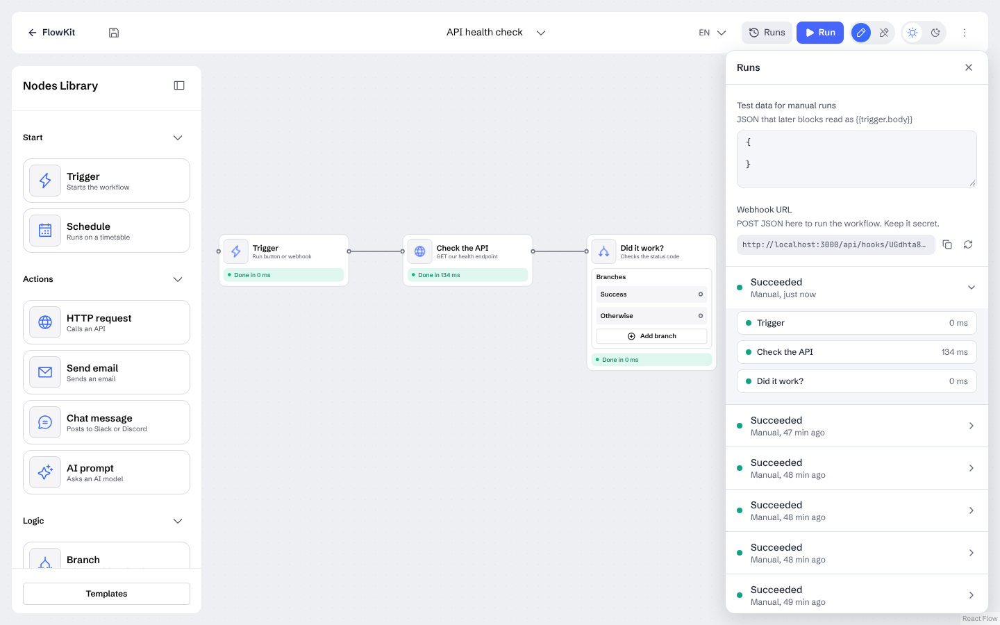

# FlowKit

A starter kit for launching your own visual automation product. Users draw workflows on a canvas, connect blocks, and run them from a button or a webhook. Sign-up, saved workflows, an execution engine, run history and subscription billing are already built, so you can focus on the blocks that make your product different.



**What's inside**

- **Visual editor** built on [Workflow Builder](https://www.workflowbuilder.io/) (Synergy Codes' open-source React SDK), with ten ready blocks: Trigger, Schedule, HTTP request, Send email, Chat message (Slack/Discord), AI prompt, Branch, Filter, Transform data and Delay.
- **Execution engine** that runs a saved workflow block by block, follows branches, waits for joins and records every step.
- **Run history** in the editor, plus a live result line on each block of the canvas.
- **Webhook trigger** for every workflow, with an option to wait for the result.
- **Schedules**: workflows can run every few minutes, hourly, daily or weekly, in any time zone.
- **Accounts** with email and password, plus optional GitHub and Google sign-in ([Better Auth](https://www.better-auth.com/)).
- **Subscriptions** through [Lemon Squeezy](https://www.lemonsqueezy.com/): checkout, signed webhooks, customer portal and plan limits.
- **Landing page** with an interactive hero, product shots, example workflows, pricing, FAQ, and template **privacy policy** and **terms** pages.
- **Light and dark theme** across the app and the editor, with a switch in every header.
- **Zero-setup local database**: `npm run dev` starts an embedded Postgres. Production uses any Postgres.

**Stack:** Next.js 16, React 19, TypeScript, Tailwind CSS 4, shadcn/ui-style components, Drizzle ORM, Postgres, Better Auth, Lemon Squeezy.

---

## Quick start

Requirements: Node.js 22 or newer (npm comes with it).

```bash
npm install
cp .env.example .env
```

On Windows, use `copy .env.example .env` for the second line.

Open `.env` and set `BETTER_AUTH_SECRET` to a long random string of 40 or more characters (`openssl rand -base64 32` makes one). Everything else can stay as it is for now. Then:

```bash
npm run dev
```

Open http://localhost:3000, create an account and press **New workflow**. A new workflow comes with a small example (Trigger, HTTP request, Branch) that you can run straight away.

`npm run dev` starts three things: an embedded Postgres on port 54322 (data is kept in `.data/`), the database migrations, and the Next.js dev server. Delete `.data/` to start over with an empty database.

### Scripts

| Command | What it does |
| --- | --- |
| `npm run dev` | Local database, migrations and the app, all at once |
| `npm run build` / `npm start` | Production build and server |
| `npm run db:migrate` | Applies database migrations to `DATABASE_URL` |
| `npm run db:generate` | Creates a migration after you change `src/db/schema.ts` |
| `npm run db:studio` | Opens Drizzle Studio to browse the database |
| `npm test` | Tests for the execution engine |
| `npm run typecheck` / `npm run lint` | TypeScript and ESLint |

---

## How the project is organized

```
src/
  app/
    (marketing)/       Landing page, privacy policy, terms
    (auth)/            Sign in and sign up
    (app)/             Workflows list and settings (signed-in pages)
    (editor)/          The full-screen editor
    api/               Route handlers (workflows, runs, webhooks, billing, auth)
  nodes/               One folder per block: editor.ts (form) + executor.ts (server code)
  engine/              Runs workflows: graph runner, {{variables}}, private-network guard
  editor/              Editor integration: Run button, runs panel, results on blocks
  lib/                 Auth, data access, plan limits, billing
  db/                  Drizzle schema and client
  config/              Brand name and pricing plans
drizzle/               SQL migrations
```

Two files hold most of what you'll change first:

- `src/config/site.ts`: product name, description, support email, and the company name and country used in the footer and legal pages.
- `src/config/plans.ts`: plan names, prices, features and limits.

Colors and fonts live as tokens at the top of `src/app/globals.css`, with a light set and a dark set. The logo is the SVG in `src/components/brand-mark.tsx`. Landing page copy sits next to each section in `src/components/marketing/sections.tsx`, and the screenshots it shows are in `public/product/`; replace them once your product looks different.

### Theme

The app follows the visitor's system setting until they press the sun/moon button; the choice is remembered in the browser. The editor uses the same setting, so switching in either place switches both. Dark mode is driven by `data-theme="dark"` on `<html>`; use Tailwind's `dark:` prefix or the tokens in `globals.css` for new UI.

### Legal pages

`/privacy` and `/terms` are starting templates written for a typical subscription product built on this kit. Fill in `legalName`, `legalCountry` and `legalUpdated` in `src/config/site.ts`, adjust the text to what your business does, and have a lawyer review them before launch.

---

## Blocks

| Block | What it does | Needs |
| --- | --- | --- |
| Trigger | Starts a run from the Run button or the workflow's webhook URL | |
| Schedule | Starts runs every few minutes, hourly, daily or weekly | the scheduler (see [Schedules](#schedules)) |
| HTTP request | Calls any API | |
| Send email | Sends a plain-text email | `RESEND_API_KEY`, `EMAIL_FROM` |
| Chat message | Posts to a Slack or Discord channel through its incoming webhook | |
| AI prompt | Asks an OpenAI-compatible model | `AI_API_KEY` |
| Branch | Continues down the first path whose conditions match | |
| Filter | Continues only when a condition is true | |
| Transform data | Builds a new object from `name = value` lines | |
| Delay | Waits up to 60 seconds | |

In the editor, the palette shows them in three groups (Start, Actions, Logic); the groups are set in `src/nodes/editor.ts`.

Each block is a folder in `src/nodes/` with two files:

- **`editor.ts`** describes how the block looks in the palette and which fields it has. It runs in the browser.
- **`executor.ts`** is what the block does when a workflow runs. It runs on the server only, so API keys and secrets are safe there.

### Adding a block

As an example, here is a "Telegram message" block.

**1. Create `src/nodes/telegram-message/editor.ts`**

```ts
import type { NodeSchema, PaletteItem, UISchema } from '@workflowbuilder/sdk';
import { getScope, globalControls, sharedProperties, statusOptions } from '@workflowbuilder/sdk';

const schema = {
  type: 'object',
  required: ['chatId', 'text'],
  properties: {
    ...sharedProperties,
    status: { type: 'string', options: Object.values(statusOptions) },
    chatId: { type: 'string' },
    text: { type: 'string' },
  },
} satisfies NodeSchema;

type Schema = typeof schema;
const scope = getScope<Schema>;

const uischema: UISchema = {
  type: 'VerticalLayout',
  elements: [
    ...globalControls,
    { type: 'Text', scope: scope('properties.label'), label: 'Title' },
    { type: 'Text', scope: scope('properties.chatId'), label: 'Chat ID' },
    // VariableTextArea lets users insert data from earlier blocks with a picker.
    { type: 'VariableTextArea', scope: scope('properties.text'), label: 'Message', minRows: 3 },
  ],
};

export const telegramMessageNode: PaletteItem<Schema> = {
  type: 'telegram-message',
  icon: 'TelegramLogo',
  label: 'Telegram message',
  description: 'Sends a Telegram message',
  defaultPropertiesData: { label: 'Telegram message', description: 'Sends a Telegram message', status: 'active', chatId: '', text: '' },
  schema,
  uischema,
  // Fields later blocks can pick in the variable picker.
  outputSchema: { type: 'default', properties: { ok: { type: 'boolean', label: 'Sent' } } },
};
```

**2. Create `src/nodes/telegram-message/executor.ts`**

```ts
import { type NodeExecutor, NodeError } from '@/engine/types';

export const executeTelegramMessage: NodeExecutor<{ chatId?: string; text?: string }> = async ({ properties, resolve, context }) => {
  const token = process.env.TELEGRAM_BOT_TOKEN;
  if (!token) throw new NodeError('Telegram is not set up. Add TELEGRAM_BOT_TOKEN.');

  const response = await fetch(`https://api.telegram.org/bot${token}/sendMessage`, {
    method: 'POST',
    headers: { 'content-type': 'application/json' },
    body: JSON.stringify({ chat_id: resolve(properties.chatId ?? ''), text: resolve(properties.text ?? '') }), // resolve() fills in {{...}}
    signal: context.signal,
  });
  return { output: { ok: response.ok } };
};
```

**3. Register it** in `src/nodes/editor.ts` (add `telegramMessageNode` to one of the groups in `paletteItems`) and in `src/nodes/executors.ts` (add `'telegram-message': executeTelegramMessage`). The `type` must be the same in both.

That's all. The block appears in the palette, its fields show in the properties panel, and runs use your executor.

Things an executor can do:

- Return `{ output }` to pass data on. Later blocks read it as `{{nodes.<blockId>.<field>}}`.
- Use `resolve(text)` to fill in `{{...}}` references as text, or `resolveValue(text)` to keep a lone reference's type (a list stays a list).
- Return `{ nextPort: '<handle id>' }` to continue along only one output (see `src/nodes/branch/executor.ts`), or `{ nextPort: null }` to stop this path.
- Throw `NodeError` with a message the user can act on. It appears in the run log and on the block.
- Use `context.signal` for anything slow, so runs stop cleanly at the time limit.

Icon names come from [Phosphor Icons](https://phosphoricons.com/) (for example `Lightning`, `Globe`, `Timer`). The editor field types (`Text`, `TextArea`, `Select`, `Switch`, `VariableText`, `VariableTextArea`, `DecisionBranches` and more) are documented in the [Workflow Builder node schema guide](https://www.workflowbuilder.io/docs/node-schemas/).

### Referencing data

Text fields can contain references that are filled in when the workflow runs. The editor's variable picker inserts them for you.

| Reference | Value |
| --- | --- |
| `{{trigger.body.email}}` | A field from the webhook body or the manual run's test data |
| `{{nodes.<blockId>.status}}` | A field from an earlier block's output |
| `{{global.<variable>}}` | A workflow variable (set in the editor's settings) |
| `{{nodes.x.y?}}` | Empty instead of an error when the value is missing |
| `{{nodes.x.y \| default:'none'}}` | A fallback when the value is missing |

Objects and lists are inserted as JSON.

### How runs work

- A run starts from the workflow's start block (Trigger or Schedule; one per workflow). Blocks run once everything connected into them has finished.
- On a Branch, only the first matching branch continues; blocks on the other paths are marked **Skipped**. A Filter whose condition is false skips everything after it.
- Blocks set to **Disabled** or **Draft** in the editor are passed over, and the flow continues after them.
- Loops are not allowed. A run stops after 200 blocks or 5 minutes.
- Each run is saved with its input and every block's output (outputs over 20 KB are shortened).

---

## Webhooks

Every workflow has a secret URL, shown in the editor's **Runs** panel:

```bash
curl -X POST https://your-app.com/api/hooks/<token> \
  -H 'content-type: application/json' \
  -d '{"email": "ada@example.com"}'
```

The body becomes `{{trigger.body}}`. The response is `202` with a `runId` straight away, and the run continues in the background. Add `?wait=true` to wait for the run and get the last block's output in the response.

The URL is the secret. Users can replace it from the Runs panel, which stops the old one working immediately.

---

## Billing with Lemon Squeezy

Billing is optional while you build. Without keys, everyone is on the Free plan and the settings page says billing isn't connected.

1. In Lemon Squeezy, create one **subscription product** with a variant for each paid plan (Pro and Business). Copy the **variant IDs** into `LEMONSQUEEZY_PRO_VARIANT_ID` and `LEMONSQUEEZY_BUSINESS_VARIANT_ID`. Keeping both plans in one product lets customers switch between them in the customer portal.
2. Under **Settings → API**, create an API key and put it in `LEMONSQUEEZY_API_KEY`.
3. Under **Settings → Stores**, copy the store ID into `LEMONSQUEEZY_STORE_ID`.
4. Under **Settings → Webhooks**, add a webhook:
   - URL: `https://your-app.com/api/webhooks/lemonsqueezy`
   - Signing secret: any long random string; put the same value in `LEMONSQUEEZY_WEBHOOK_SECRET`
   - Events: all `subscription_*` events
5. Set the prices shown on the landing page in `src/config/plans.ts`, matching what you set in Lemon Squeezy.

How it fits together: the settings page shows an **Upgrade** button for each paid plan that has a variant ID. It sends the user to a Lemon Squeezy checkout with their user ID attached. Lemon Squeezy then calls the webhook, which checks the signature and stores the subscription. The plan is read from that record (`src/lib/limits.ts`), so limits change as soon as the webhook arrives. **Manage billing** opens the Lemon Squeezy customer portal, where users change cards, download invoices or cancel. A cancelled plan keeps working until the end of the paid period.

Use Lemon Squeezy's test mode while trying this out. To test webhooks on your own computer, expose it with a tunnel such as `ngrok http 3000` and use that URL.

The kit comes with three plans: Free, Pro and Business. To add or remove one, edit `plans` in `src/config/plans.ts` (and the `PlanId` type above it); a paid plan needs its own variant ID env var. Pricing cards, upgrade buttons and limits all follow that file. Mark one plan `highlighted: true` to show it as "Most popular".

---

## Sign-in options

Email and password works out of the box. To add social sign-in, set both values for a provider in `.env`; the button appears on the sign-in page automatically.

- **GitHub**: create an OAuth app at github.com/settings/developers. Callback URL: `https://your-app.com/api/auth/callback/github`.
- **Google**: create an OAuth client in Google Cloud Console. Redirect URI: `https://your-app.com/api/auth/callback/google`.

Better Auth supports many more providers and features (magic links, two-factor, organizations). Add them in `src/lib/auth.ts`; see the [Better Auth docs](https://www.better-auth.com/docs).

---

## Schedules

A workflow that starts with a Schedule block runs on its own. Each workflow stores its next start time, recalculated when it's saved, and a scheduler starts the ones that are due once a minute (`src/lib/scheduler.ts`). Times follow the time zone set in the block, including daylight-saving changes. Scheduled runs count towards the plan's monthly runs; when a user is over the limit, scheduled runs are skipped until the next month.

Something has to wake the scheduler every minute:

- **Your own server** (`npm run dev`, `npm start`, Docker, a VPS): nothing to do. A built-in timer in `src/instrumentation.ts` does it. If you run several copies of the app, that's fine; a run is never started twice.
- **Vercel on the Pro plan**: set `CRON_SECRET` to a long random string, then add a `vercel.json` with `{ "crons": [{ "path": "/api/cron/tick", "schedule": "* * * * *" }] }`. Vercel sends the secret automatically.
- **Vercel Hobby or other serverless hosts**: Hobby limits cron jobs to once a day (check Vercel's current limits), so use a free external service such as cron-job.org instead. Set `CRON_SECRET`, then have it call `GET https://your-app.com/api/cron/tick` every minute with the header `Authorization: Bearer <CRON_SECRET>`.

---

## Email and chat blocks

**Send email** uses [Resend](https://resend.com): verify your domain there, then set `RESEND_API_KEY` and `EMAIL_FROM` (for example `FlowKit <hello@yourdomain.com>`). To use another provider, change the one `fetch` call in `src/nodes/send-email/executor.ts`.

**Chat message** needs no setup on your side. Users paste an incoming webhook URL from their own Slack or Discord channel into the block.

---

## AI prompt block

Works with any OpenAI-compatible API: OpenAI, OpenRouter, Groq, Together, Mistral, a local Ollama and others. Set `AI_API_KEY`, `AI_BASE_URL` and `AI_MODEL` in `.env`. Users can override the model per block.

---

## Deploy

The kit runs anywhere Next.js runs. The steps below use Vercel and a hosted Postgres (Neon or Supabase both have free tiers).

1. Create a Postgres database and copy its connection string.
2. Import the repository into Vercel.
3. Add the environment variables from `.env.example`. Set `DATABASE_URL` to your database, and `NEXT_PUBLIC_APP_URL` and `BETTER_AUTH_URL` to your app's address. Leave `ALLOW_PRIVATE_HTTP` as `false`.
4. Set the build command to `npm run db:migrate && npm run build`, so each deploy applies new migrations first.
5. Deploy, then set up the Lemon Squeezy webhook with your live URL.

`/api/health` returns 200 when the app and database are up, for uptime monitors.

### Long-running workflows

Runs execute inside the server request that started them (using Next.js `after()`, or the scheduler's request for scheduled runs), so they finish within the platform's function time limit; the run routes ask for 300 seconds. That's why Delay blocks are capped at 60 seconds. For workflows that wait hours or days, or for heavy traffic, move `executeRun` (in `src/lib/runs.ts`) onto a job queue such as Inngest, Trigger.dev or a worker with pg-boss. The engine itself doesn't need to change. Workflow Builder also offers a Temporal-based execution backend for this kind of setup.

---

## Security notes

- **Data access**: every query in `src/lib/workflows.ts` and `src/lib/runs.ts` is scoped to the signed-in user, so one user can never read or change another's workflows.
- **Private networks**: HTTP blocks refuse local and private addresses (localhost, 10.x, 192.168.x, cloud metadata at 169.254.169.254), including after redirects. This stops users from reaching your internal network through your server. A determined attacker controlling DNS could still race this check, so if your app runs next to sensitive internal services, also restrict outbound traffic at the network level.
- **Webhooks**: Lemon Squeezy webhooks are verified with HMAC signatures. Workflow webhook URLs contain a 32-character random token.
- **Rate limits**: Better Auth rate-limits sign-in attempts in production. Workflow webhooks are limited by each plan's monthly run allowance; add a per-IP limit at your host or CDN if you expect abuse.
- **Secrets**: API keys stay on the server. Executors read them from environment variables; nothing secret is sent to the browser.

---

## Updating Workflow Builder

The editor comes from the `@workflowbuilder/sdk` npm package, so updates arrive with `npm update @workflowbuilder/sdk`. Read its changelog first: the kit uses the SDK's 3.0 API (decorator slots like `OptionalAppBarControls` and `OptionalNodeContent`), and later major versions may rename them.

One cosmetic workaround to know about: SDK 3.0 shows a placeholder "Folder Name" label in the editor's top bar, which is hidden by a CSS rule in `src/app/globals.css`.

---

## Licenses

Workflow Builder Community Edition is © Synergy Codes and licensed under the Apache License 2.0. It's installed from npm and its license ships with the package. If you redistribute the SDK's code in another form, keep its license and notices. Synergy Codes sells an Enterprise Edition with extra plugins and support; it is not included in this kit.

Other dependencies are under their own open-source licenses (mostly MIT); see each package in `node_modules`.
